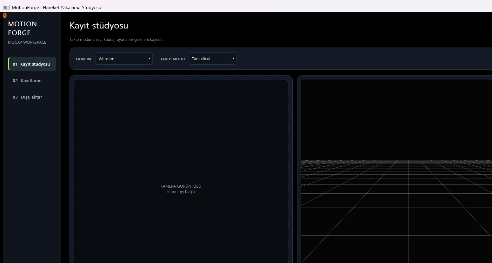

# MotionForge

**Webcam motion capture for Blender and Unity.**

MotionForge Studio turns a webcam performance into pose recordings you can review and export. It is an open-source Windows desktop app for creators who want a lightweight starting point for markerless motion capture.



[Get the Windows preview](https://github.com/Efeyasin46/Python-Mocap/releases/tag/v0.1.0-alpha.2) · [Report a bug](https://github.com/Efeyasin46/Python-Mocap/issues/new?template=bug_report.yml)

> Preview software: tracking depends on camera placement, lighting, clothing, and visibility. Check motion exports in your target project.
## What you can do

- Capture a pose stream from a webcam.
- Choose full-body pose tracking or face-mesh landmark capture.
- Set a 0–30 second recording countdown so the performer can get into position.
- Exclude low-confidence landmarks from new live takes; missing landmarks stay missing instead of being held from a previous frame.
- Name each take and choose its save folder when recording stops; recordings use versioned MotionForge JSON.
- Review takes in the built-in 3D viewer with playback and scrubbing.
- Bake a video or an existing JSON take through the smoothing and floor-alignment filters.
- Export Blender-oriented JSON and BVH, or Unity point-animation JSON.

### Planned for a future release

- Mobile camera over USB
- Mobile camera over Wi-Fi

## Quick start

Requirements: Windows 10/11, Python 3.11, and a camera for live capture. Video processing and review do not require a camera.

```powershell
git clone https://github.com/Efeyasin46/Python-Mocap.git
cd MotionForge
uv sync --extra dev
uv run python src/nexus.py
```

If you do not have `uv`, install it from [astral.sh/uv](https://docs.astral.sh/uv/), or create a Python 3.11 virtual environment and install the project with `pip install -e ".[dev]"`.

### Build a Windows app folder

```powershell
build_windows.bat
```

The build script creates an onedir package at `dist/MotionForge/`. Keep the whole folder together when running the app. Packaging and camera support are still being validated across different Windows machines.

## Typical workflow

1. Open **Studio**, choose a camera, and connect.
2. Start and stop a take. MotionForge saves recordings under `data/`.
3. Open **Library** to preview, scrub, and select a take.
4. Open **Export**, choose the output file name and location, then create Blender or Unity files. Blender export places its related files beside the chosen file.
5. Use **Bake video or JSON** when you want to run the offline filters on a source clip or an existing take.

## Output formats

| Format | Intended use |
|---|---|
| MotionForge JSON | Reopen, review, and process a take in MotionForge |
| BVH | Import motion into tools such as Blender |
| Blender JSON | MotionForge's Blender bridge and diagnostics |
| Unity JSON | Point animation using the example reader in `examples/unity/` |

BVH and point-animation exports are based on estimated landmarks. They are not a calibrated, fully rigged human animation; verify scale, axes, and retargeting in your destination project.

## Development

```powershell
uv sync --extra dev
uv run pytest -q
uv run python -m compileall -q src tests
```

See [docs/ARCHITECTURE.md](docs/ARCHITECTURE.md), [docs/CONVENTIONS.md](docs/CONVENTIONS.md), and [HANDOFF.md](HANDOFF.md) for the current design and known work.

## Contributing

Bug reports and small, focused pull requests are welcome. Include your Windows/Python versions, camera or video source, steps to reproduce, and a short log excerpt. Do not commit recordings containing identifiable faces without permission from the people shown. See [CONTRIBUTING.md](CONTRIBUTING.md).

## License

MotionForge is distributed under the license in [LICENSE](LICENSE).

---

## Türkçe

MotionForge, web kamerasından poz verisi çıkarıp kayıtları incelemek ve dışa aktarmak için geliştirilen açık kaynaklı bir masaüstü uygulaması prototipidir.

- Web kamerasından kayıt alır.
- Tam vücut pozu veya yüz ağı işaret noktaları yakalama modu seçilebilir.
- Mobil kamera desteği (USB ve Wi-Fi) sonraki sürümler için planlanıyor.
- Kayıtları sürümlü MotionForge JSON biçiminde saklar.
- Kayıtları 3D görüntüleyicide oynatıp zaman çizgisinde tarar.
- Video veya mevcut JSON kaydına çevrimdışı yumuşatma ve zemin hizalama uygular.
- Blender için BVH/JSON, Unity için nokta animasyonu JSON’u üretir.

### Hızlı başlangıç

Windows 10/11 ve Python 3.11 gerekir. Canlı kayıt için kamera gerekir; mevcut kayıtları görüntülemek veya video işlemek için kamera gerekmez.

```powershell
uv sync --extra dev
uv run python src/nexus.py
```

Ardından **Studio** bölümünden kamerayı bağla, **Library** bölümünden kayıtları izle, **Export** bölümünden çıktı biçimini seç. Kayıtlar `data/` klasörüne yazılır.

> Takipsiz poz tahmini; ışık, kamera açısı, kıyafet ve kişinin görünürlüğünden etkilenir. Dışa aktarılan hareketi hedef uygulamada kontrol et. Proje geliştirme aşamasındadır; BVH/Unity çıktıları hazır rig animasyonu veya kalibre edilmiş ölçüm garantisi vermez.
