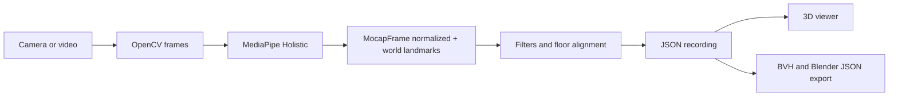
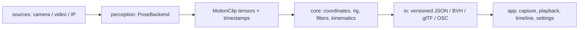

# MotionForge architecture

## Current pipeline

The current implementation is a desktop prototype. Capture and bake own their
processing loops; `MocapFrame` is the persisted interchange model. The world
landmark coordinates are metres with MediaPipe axes (X right, Y down, Z depth).

## Target pipeline

The target separates hardware and GUI dependencies from pure motion processing.
`MocapFrame` remains as a compatibility reader while new recordings migrate to
a versioned clip format. This is incremental: existing launch scripts remain
usable during migration.
